# Floorplan Studio – handleiding

Met Floorplan Studio maak je een interactieve plattegrond van je huis voor je Home Assistant-dashboards. Je tekent hem zelf in een paar minuten zonder code, of je trekt hem over van de kaart van je robotstofzuiger of van een foto van de bouwtekening.


> Alle schermafbeeldingen in deze handleiding komen uit het **Voorbeeldhuis**: een verzonnen huis met nep-apparaten (Anna, Tom, "Camera voordeur"…). Je kunt het zelf inladen, zie [Uitproberen met het voorbeeldhuis](#7-uitproberen-met-het-voorbeeldhuis).

**Inhoud**
1. [Installeren](#1-installeren)
2. [Je plattegrond maken – stap voor stap](#2-je-plattegrond-maken--stap-voor-stap)
3. [Het dashboard](#3-het-dashboard)
4. [De kaart gebruiken](#4-de-kaart-gebruiken)
5. [Extra's: zijkolom, tekstblokken, temperatuur, aanwezigheid, radar, meldingen, stofzuiger](#5-extras)
6. [Thema's](#6-themas)
7. [Uitproberen met het voorbeeldhuis](#7-uitproberen-met-het-voorbeeldhuis)
8. [Tips](#8-tips)
9. [Problemen oplossen](#9-problemen-oplossen)

---

## 1. Installeren

### Met één klik
1. [](https://my.home-assistant.io/redirect/hacs_repository/?owner=trackerr&repository=home-assistant-floorplan-studio&category=integration)  
   Opent Floorplan Studio meteen in HACS. Klik **Downloaden** en **herstart Home Assistant**.
2. Pas **na de herstart**: [](https://my.home-assistant.io/redirect/config_flow_start/?domain=floorplan_studio)  
   Voegt de integratie toe. Klik **Verzenden**.

Klik je knop 2 vóór het downloaden of vóór de herstart, dan zegt Home Assistant *"Deze integratie ondersteunt geen configuratie via de UI"*. Er is dan niets mis: Home Assistant kent Floorplan Studio gewoon nog niet. Download hem in HACS, herstart, en klik dan opnieuw op knop 2.

De knoppen openen je eigen Home Assistant via my.home-assistant.io. De eerste keer vraagt die om het adres van je Home Assistant (bijv. `http://homeassistant.local:8123`).

Daarna staat Floorplan Studio bij **Instellingen → Apparaten & diensten** met één dienst. Open die voor de versie en de knop **Bezoek**: die gaat naar deze pagina op GitHub. Het linkje *Aangepaste integratie* zet Home Assistant zelf bij elke integratie die niet standaard in Home Assistant zit; dat gaat altijd naar de uitleg op de site van Home Assistant.

### Via HACS (met de hand)
1. Open **HACS** → menu **⋮** rechtsboven → **Aangepaste repositories**.
2. Plak `https://github.com/trackerr/home-assistant-floorplan-studio` en kies type **Integratie**.
3. Zoek **Floorplan Studio**, klik **Downloaden** en **herstart Home Assistant**.
4. Ga naar **Instellingen → Apparaten & diensten → Integratie toevoegen** en kies **Floorplan Studio**. Klik op **Verzenden**.

Daarna staat **Floorplan** in je zijbalk. De kaart wordt automatisch geladen, dus je hoeft geen *resource* toe te voegen.

### Met de hand
Kopieer de map `custom_components/floorplan_studio` naar `config/custom_components/` in je Home Assistant-configuratie, herstart HA en voeg de integratie toe zoals in stap 4 hierboven.

> **Tip:** Floorplan Studio haalt veel informatie uit je **areas** (ruimtes in HA). Kijk voor je begint even of je lampen, sensoren en apparaten aan de juiste area hangen: **Instellingen → Areas, labels & zones**.

---

## 2. Je plattegrond maken – stap voor stap

Klik in de zijbalk op **Floorplan**. Bovenaan staan zes stappen; je kunt altijd heen en weer springen.

- **Opslaan** zit rechtsboven en kan op elk moment.
- **Ongedaan maken** gaat met de ↶-knop of **Ctrl+Z**.
- **Verwijderen** van wat geselecteerd is gaat met de **Delete**-toets.
- Met **+** maak je een nieuwe plattegrond (bijv. een tweede verdieping), met de knoppen ernaast **importeer** of **exporteer** je een plattegrond als JSON-bestand.

### Stap 1 – Achtergrond


1. Geef je plattegrond een **naam**, bijvoorbeeld "Begane grond".
2. Kies waar je plattegrond vandaan komt:

   | Keuze | Wanneer |
   |---|---|
   | **Plaatje uploaden** | Je hebt een bouwtekening, foto, schets of screenshot uit je stofzuiger-app. |
   | **Kaart van je robotstofzuiger (of een camera)** | Je hebt Roborock, Valetudo, Xiaomi Cloud Map Extractor of een andere integratie met een `image.`-entiteit van de kaart. Kies hem in de lijst en klik **Gebruiken**. |
   | **Zonder voorbeeld tekenen** | Je hebt geen afbeelding. Je tekent dan gewoon op het raster. |

3. Stel met de schuifjes de **doorzichtigheid**, **schaal** en **positie** in, zodat de achtergrond mooi op het raster valt. **Passend maken** zet hem in één klik passend.
4. Ligt de kaart een kwartslag gedraaid of gespiegeld (stofzuigerkaarten doen dat vaak)? Gebruik bij **Draaien** de knoppen **90° links** / **90° rechts** en **Spiegelen** tot hij goed ligt.

De achtergrond is alleen een hulp om over te trekken: op je dashboard zie je hem niet. Komt hij van je stofzuigerkaart, dan onthoudt Floorplan Studio dat (ook hoe je hem gedraaid hebt). Daardoor kan de **live stofzuigerkaart** later precies over je plattegrond vallen, zie [hoofdstuk 5](#de-stofzuiger-live-op-de-kaart).

Klik **Volgende**.

### Stap 2 – Ruimtes


1. Kies **Ruimte tekenen** en **sleep een rechthoek** over elke kamer.
2. Is een kamer L-vormig, zoals de woonkamer hierboven? Selecteer de ruimte, kies **Stuk aan ruimte toevoegen** en teken het extra stuk erbij. Samen vormen ze één ruimte zonder muur ertussen.
3. Met **Kiezen en verschuiven** kun je een ruimte verslepen, de **hoekpuntjes** verslepen om de maat te veranderen, en de ruimte een naam geven.
4. Optioneel per ruimte:
   - **Grote waarde**: wat groot in het tekstblok staat. Standaard de temperatuur, maar het kan elke sensor zijn (bijv. het vermogen van de zonnepanelen bij het kantoor).
   - **Extra regels in het tekstblok**: tot drie apparaten of sensoren uit die area, bijv. de vaatwasser of de 3D-printer.
   - **Vloer**: gewoon, tegels (badkamer, wc) of hout.

   Deze staan onder **Meer opties**, zodat het rustig blijft.
5. **Echte maten:** vul bij één ruimte de **echte breedte of lengte** in meters in. Daarna staat bij elke ruimte de maat op de tekening (bijv. "4,00 × 3,15 m"), krijgt de gekozen ruimte maatlijnen, en zie je de oppervlakte in m². Meubels krijgen hun maat in cm en de radar weet hoe ver een meter is. Klopt de ene kant wel en de andere niet, dan is de ruimte scheef getekend: maak hem groter of kleiner met de hoekjes.
6. **Koppel elke ruimte aan een Home Assistant-area.** Dat is de belangrijkste stap. Daardoor:
   - weet de ruimte welke lampen en apparaten erbij horen;
   - zoekt hij automatisch de **temperatuur** en **vochtigheid** (zijn er meerdere sensoren, dan kies je er hier één);
   - werken aanwezigheid, meldingen en "deze ruimte zuigen" vanzelf.

**Muren hoef je niet te tekenen.** Waar twee ruimtes elkaar raken komt een binnenmuur, waar niets naast ligt een buitenmuur.

> **Inzoomen:** boven de tekening kies je een ruimte om op in te zoomen (of dubbelklik op een ruimte bij stap 4). Handig om precies te werken.

> **Snel beginnen:** met **Ruimtes overnemen uit Home Assistant** krijg je voor elke area alvast een rechthoek. Die schuif en rek je daarna op de goede plek.

### Stap 3 – Deuren, ramen en meubels


1. Kies **Deur**, **Raam** of **Open doorgang** en **klik op een muur**.
   - Een **deur** maakt een opening met kleine deurposten.
   - Een **raam** tekent glas in de muur.
   - Een **open doorgang** haalt de muur weg, bijvoorbeeld tussen woonkamer en open keuken. Met **Hele muur** wordt de complete muur open.
2. Klik op een deur of raam om de **breedte** of de soort aan te passen, of om hem te verwijderen.
3. **Koppel een deur of raam aan zijn sensor** (open/dicht). Staat hij open, dan wordt hij oranje en gestippeld op de kaart en verschijnt er een melding.

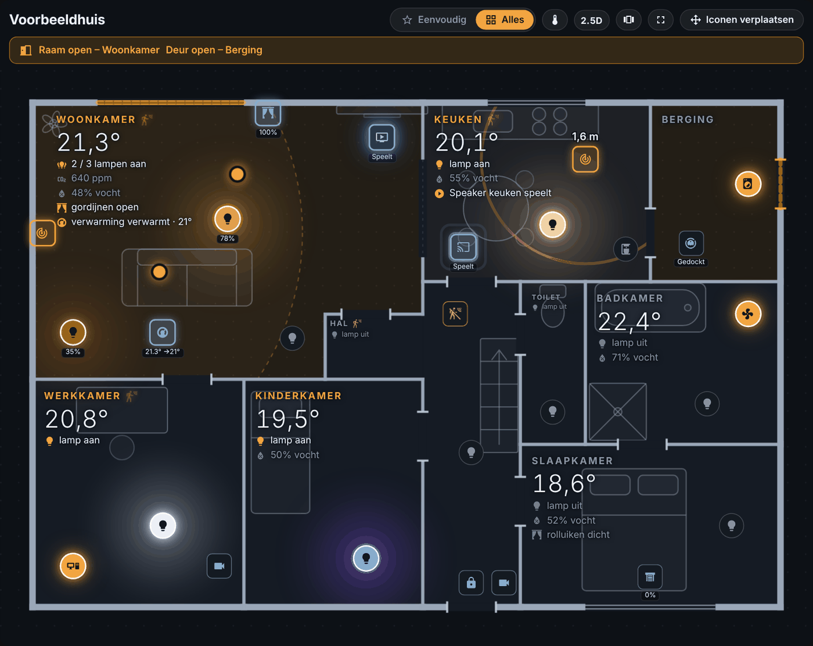

**Meubels en trap.** Onder de deuren staan knoppen voor een bank, bed, tafel, ronde tafel, bureau, aanrecht, gootsteen, kookplaat, fornuis, koelkast, kookeiland, bovenkast, kast, bad, douche, wc, trap, tv en plant. Tik erop om het neer te zetten en sleep het naar de goede plek. Daarna kun je de soort, de **breedte**, **diepte** en **hoogte** aanpassen (in cm zodra je de echte maat bij stap 2 hebt ingevuld) en het een kwartslag draaien. Op het dashboard is het een lichte omtrek; in 2.5D worden het blokken. Een L-vormige keuken maak je van twee keer **Aanrecht (blad)**, waarvan je er één een kwartslag draait. Zet daarna een **Kookplaat** of **Gootsteen** bovenop het blad: die worden dan in het blad getekend in plaats van als losse kast.

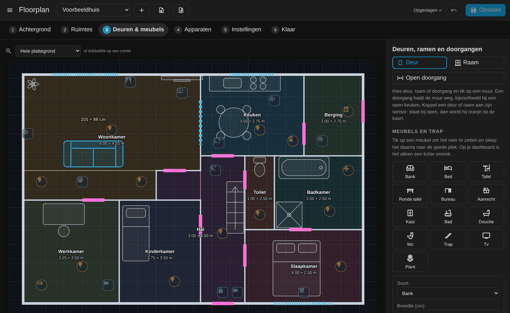

### Stap 4 – Apparaten


1. Klik op **Alles vanzelf neerzetten**. Alle lampen, schakelaars, thermostaten, gordijnen, mediaspelers, camera's enz. uit de gekoppelde areas komen in hun kamer te staan.
2. **Sleep** de iconen naar de plek waar ze echt staan. Dubbelklik op een ruimte (of kies hem boven de tekening) om in te zoomen en precies te plaatsen; dubbelklik nog eens voor de hele plattegrond.
3. Mist er iets? Zoek een entiteit in het zoekveld, of klik bij **Nog niet op de kaart** op een apparaat.
4. Klik op een icoon om:
   - een eigen **naam** te kiezen;
   - **Altijd tonen** aan te zetten (zie *Eenvoudig* in hoofdstuk 4);
   - bij een stekker of schakelaar te kiezen **wat eraan zit**: *een lamp* (lampicoon en gloed, voor een gewone lamp aan een slimme stekker) of *een apparaat, geen licht* (geen gloed, bijv. de vaatwasser);
   - het van de kaart te halen.

   Bij een lamp: **Plafondlamp?** Automatisch herkent hij een plafondlamp aan de naam (plafond, spot, hanglamp, pendant, downlight ...). Klopt dat niet, kies dan *Ja* of *Nee*. Een plafondlamp krijgt een plafondlamp-icoon, en in 2.5D hangt hij aan een rozet aan het plafond en schijnt hij een lichtbundel naar de vloer als hij aan is. Een **hanglamp** (aan een snoer): kies *Ja, hangend (hanglamp)*; dan verschijnt **Hangt op** waar je zelf de hoogte in meters invult (leeg = 2 m, of net boven de tafel als hij boven de eettafel hangt). Hij houdt het plafondlamp-icoon, en in 2.5D en de wandeling hangt hij aan een snoer op die hoogte. Namen met hanglamp, pendant of pendel worden vanzelf als hanglamp herkend.

   **WLED automatisch instellen:** heb je WLED, dan staat bovenaan stap 4 de knop **WLED automatisch instellen**. Die leest elke WLED uit via de gewone WLED-integratie (aantal leds, segmenten, matrix) en stelt hun lampen op de kaart in: teken je één lijn voor de hele strip (op de *Main*-lamp), dan krijgt elk segment zijn eigen stuk ervan, in verhouding tot zijn leds en op dezelfde hoogte; een strip zonder lijn krijgt er een langs de dichtstbijzijnde muur (uitgaande van 60 leds per meter, teken hem na voor de precieze plek); een matrix krijgt een raster-icoon; en WLED-lampen worden nooit als plafondlamp gezien. Klokken en kleine objecten met een WLED erin blijven een icoon. Met Ongedaan maken draai je het terug; pas bij Opslaan wordt het bewaard.

   **Ledstrip als lijn:** zet bij een lamp (of een stekker met een lamp eraan) **Vorm op de kaart** op *Lijn (ledstrip)* en kies **Lijn tekenen**. Tik punt voor punt langs de strip; lijnen springen naar 45° (Shift ingedrukt = vrije hoek) en je ziet meteen de lengte in meters. Dubbeltik of **Klaar** om te stoppen. Elk stuk krijgt zijn lengte op de tekening, en de totale lengte staat in het paneel. Op het dashboard gloeit de lijn in de kleur van de lamp; het icoontje (om te tikken) komt in het midden. De hoogte van de strip zet je onder **Meer opties** (handig in 2.5D en de wandeling).

   Onder **Meer opties**:
   - een eigen **icoon**;
   - een vaste **gloedkleur** (voor een stekker met een gekleurde lamp erin);
   - de **hoogte** in meters voor de 2.5D-weergave (leeg = gebruikelijk: plafondlamp hoog, thermostaat op borsthoogte, stofzuiger op de vloer). Staat een apparaat boven een tafel of kast, dan hangt het in 2.5D vanzelf net daarboven;
   - bij een lamp: **Stroom via een slimme schakelaar**. Zit een slimme lamp aan een slimme schakelaar? Kies die hier. Je ziet dan één lamp, en tikken zet de stroom aan of uit.
5. **Radar (mmWave):** zet je een aanwezigheidssensor met radar neer (bijv. Tuya 24G, LD2410 of LD2450), dan verschijnt de optie **Radar: laat zien waar iemand is**. De bijbehorende afstand- en bereiksensoren worden vanzelf gevonden. Hangt hij aan het plafond, vul dan de hoogte in. Zie [Radar](#radar-mmwave) in hoofdstuk 5.

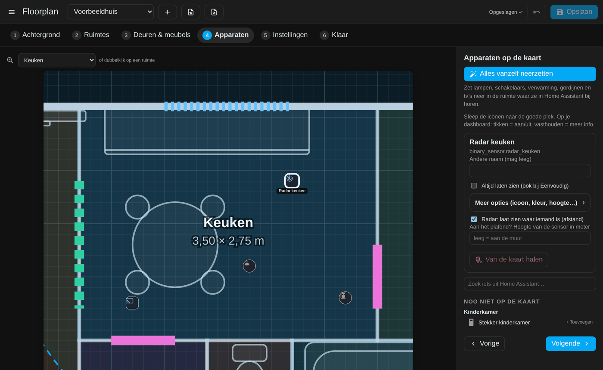

### Stap 5 – Instellingen


Alles wat je hier instelt geldt voor elke kaart die deze plattegrond toont. Rechts zie je meteen een live voorbeeld.

De instellingen zitten in onderdelen die je openklapt; alleen **Uiterlijk** staat open. Instellingen die er op dat moment niet toe doen, zie je niet: zo verschijnt de uitdooftijd van beweging pas als aanwezigheid aan staat, en het onderdeel stofzuiger alleen als je een stofzuiger hebt.

| Onderdeel | Wat stel je in |
|---|---|
| **Uiterlijk** | Standaardthema, **één thema voor het hele huis** (keuzelijst, zie hoofdstuk 6), grootte van de plattegrond (kleiner = compactere pagina), grootte van alle iconen, van **lampen** en van **andere apparaten** apart, en van de kamertekst. |
| **Licht** | Lichtvlek per lamp, hele ruimte laten gloeien of geen gloed, de sterkte van de gloed, en hoe de sterkte van een lamp getoond wordt. |
| **Tekst bij de ruimtes** | Temperatuur, vochtigheid, lampen aan, CO2, gordijnen, verwarming/airco, wat er speelt, labels onder apparaten, hoeveel regels, de begroeting en het kompas. |
| **Telefoon, tablet en 2.5D** | **Kleine schermen** (per ruimte onder een bepaalde breedte, altijd of nooit; zie hoofdstuk 4), de **hoogte in de 2.5D-weergave** (echte maat of een eigen percentage), **perspectief** aan/uit, of er hulplijntjes van de vloer naar de iconen komen, en of de iconen **vervagen tijdens draaien** (standaard aan, tot 10% zichtbaar) zodat je de vorm van het huis beter ziet. |
| **Tikken en vasthouden** | Tikken op een ruimte aan/uit en wat er dan gebeurt (**inzoomen** of de **eigen pagina** openen), wat vasthouden opent (het **snelmenu** of het venster van Home Assistant) en hoe lang. |
| **Eenvoudig** | Standaardweergave, hoeveel dagen hij terugkijkt (1–60), en tot hoeveel dagen geschiedenis hij nog alles toont terwijl hij leert. |
| **Thema Automatisch (zon)** | Alleen bij dat thema: hoeveel minuten vóór zonsopkomst het licht wordt, en hoe lang de overgang duurt. |
| **Kleur op temperatuur** | Standaard aan of uit, en bij welke temperatuur een ruimte blauw (koud) en rood (warm) is. |
| **Aanwezigheid** | Bewegingsicoontje aan/uit, hoe lang het **uitdooft** na de laatste beweging, en per persoon de sensor die zegt in welke ruimte hij of zij is. |
| **Meldingen** | Alarm (rook, gas, koolmonoxide, lekkage) en open deuren/ramen, elk los aan of uit. |
| **Stofzuiger** | Welke stofzuiger, wanneer de live kaart verschijnt en wat je dan ziet. |
| **Zijkolom** | Weer, de grote knop, drie knoppen, de energiesensoren, de statuslijst en de **slimme knop**. Leeg laten = automatisch gekozen. |
| **Alles vanzelf neerzetten** | Welke soorten apparaten *Alles vanzelf neerzetten* meeneemt. |

Met **Alles terugzetten** zet je alles in één keer terug.

### Stap 6 – Klaar


1. Klik op **Opslaan**.
2. Laat **Met startpagina "Thuis"** aangevinkt als je een overzichtspagina wilt (zie hoofdstuk 3).
3. Klik op **Dashboard maken**. Je krijgt een nieuw dashboard in de zijbalk, zie hieronder.

Je kunt de kaart ook op een bestaand dashboard zetten: bewerk het dashboard, kies **Kaart toevoegen** en dan **Floorplan Studio**.

---

## 3. Het dashboard

**Dashboard maken** zet een compleet dashboard voor je klaar. Tabbladen zonder inhoud (bijv. geen mediaspelers) worden overgeslagen.

| Tabblad | Wat staat erop |
|---|---|
| **Thuis** *(optioneel)* | Een rustige startpagina in het thema van je plattegrond: begroeting, de slimme knop, je knoppen, een tegel per kamer, energie, weer en de statuslijst. Zie hieronder. |
| **Plattegrond** | De plattegrond schermvullend. |
| **Kiosk** | De plattegrond voor een wandtablet of tv, met een menubalk naar de andere tabbladen. |
| **Energie** | Het HA-energiedashboard (of, als dat niet is ingesteld, je stroomsensoren). |
| **Buiten** | Weer, buitensensoren en buitencamera's. |
| **TV** | Je mediaspelers. |
| **Pagina per ruimte** | Elke ruimte heeft een eigen pagina (bijv. `/floorplan-…/ruimte-keuken`) die er precies zo uitziet als inzoomen op de kaart. Ze staan niet als tabblad bovenin, maar je kunt er rechtstreeks naar linken, en ze hebben een terug-pijl. |


### De startpagina Thuis

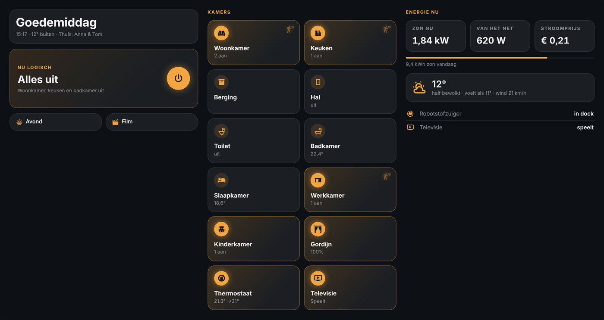

- **Links:** de begroeting met de tijd, de temperatuur buiten en wie er thuis is, de **slimme knop** (zie hoofdstuk 5) en je knoppen.
- **Midden:** een **tegel per kamer**. Een tegel gloeit als er licht aan is en zegt hoeveel ("2 aan"); anders staat er de temperatuur. **Tik** = de lampen in die kamer aan of uit. **Vasthouden** = de pagina van die kamer. Daaronder staan gordijnen, verwarming of airco en de tv als tegel (tik = aan/uit).
- **Rechts:** energie nu (zon, van of naar het net, stroomprijs), het weer en de statuslijst.

Alles neemt de kleuren en letters van je thema over. Op een telefoon komen de drie kolommen onder elkaar. Op een eigen dashboard zet je hem met:

```yaml
type: custom:floorplan-studio-card
plan: thuis
home: true
room_pages: true   # vasthouden op een kamer opent zijn pagina
```

Heb je via HACS **advanced-camera-card** of **clock-weather-card** geïnstalleerd, dan gebruikt het dashboard die automatisch voor de camera's en de klok. Zonder die kaarten werkt alles ook, met de standaardkaarten van HA.

### Volledig scherm

Tik op **⛶** in de werkbalk. De hele pagina gaat op volledig scherm, de kop- en zijbalk van Home Assistant verdwijnen en in de zijkolom (en bovenaan Energie, Buiten en TV) verschijnt de menubalk. Wissel je via die menubalk van tabblad, dan blijft alles op volledig scherm. Met **Esc** of nog een keer **⛶** ga je terug.

### Kiosk (wandtablet / tv)


1. Installeer via HACS **[Kiosk Mode](https://github.com/NemesisRE/kiosk-mode)**. Die verbergt de kopbalk en zijbalk van HA.
2. Open op de tablet het kiosk-tabblad met `?kiosk` erachter, bijvoorbeeld `http://homeassistant.local:8123/floorplan-thuis/kiosk?kiosk`. De link staat ook bij stap 6 na het maken.
3. Onderaan de plattegrond (en bovenaan Energie, Buiten en TV) verschijnt een **menubalk**. Daarmee wissel je van tabblad terwijl je in kiosk blijft.

Zonder `?kiosk` in het adres is de menubalk onzichtbaar; dan gebruik je gewoon de normale tabbladen.

---

## 4. De kaart gebruiken

| Actie | Wat er gebeurt |
|---|---|
| **Tik op een lamp of apparaat** | Aan/uit (lampen, schakelaars, gordijnen, mediaspelers). Andere apparaten openen de details. |
| **Tik op een camera** | Live beeld over de kaart. Tik op het beeld om het te sluiten. |
| **Houd een icoon vast** | Het **snelmenu**: aan/uit en schuifjes voor helderheid, kleurtemperatuur, stand van gordijnen, ventilator of volume; bij de verwarming − en +. Met **Meer…** open je het venster van Home Assistant. (Bij stap 5 kun je kiezen dat vasthouden meteen dat venster opent.) |
| **Wijs een icoon aan** (muis) | Naam en wat hij doet, bijv. "Televisie · Speelt" of "Plafondlamp · 78%". |
| **Tik op een kamer** | Inzoomen op die kamer, of de eigen pagina van de kamer openen (instelling bij stap 5). |
| **Terug / tik buiten de kamer** | Weer uitzoomen. |
| **Eenvoudig / Alles** | Alleen wat jullie de laatste tijd gebruiken, of alles. |
| **Knijpen** (telefoon) of **Ctrl + scrollwiel** (pc) | Vrij in- en uitzoomen op de plattegrond; daarna slepen om te schuiven. Met **Hele plattegrond** terug. |
| **2.5D** | De plattegrond schuin, met muren en meubels in 3D. Zie [2.5D](#25d-schuin-van-opzij). |
| **Begane grond / Verdieping** | Wisselen tussen verdiepingen (als de kaart er meer heeft). |
| **🌡 (thermometer)** | Ruimtes kleuren op temperatuur aan/uit. |
| **Grote knop in de zijkolom** | Alles uit (of je eigen script/scène). |
| **⛶ (volledig scherm)** | De hele pagina op volledig scherm, zonder de balken van Home Assistant, met een menubalk. Blijft aan als je van tabblad wisselt; **Esc** of nog eens ⛶ = terug. |
| **Tekstblok slepen / vasthouden** (alleen beheerders) | Slepen = verplaatsen, het oranje hoekje = groter/kleiner, vasthouden = menu. Zie [De tekstblokken bij de ruimtes](#de-tekstblokken-bij-de-ruimtes). |
| **Iconen verplaatsen** (alleen beheerders) | Iconen (en tekstblokken) direct op de kaart verslepen. Ze worden meteen opgeslagen. Kan ook ingezoomd op een ruimte (knop in het paneel). In 2.5D schakelt de kaart daarvoor even naar 2D. |

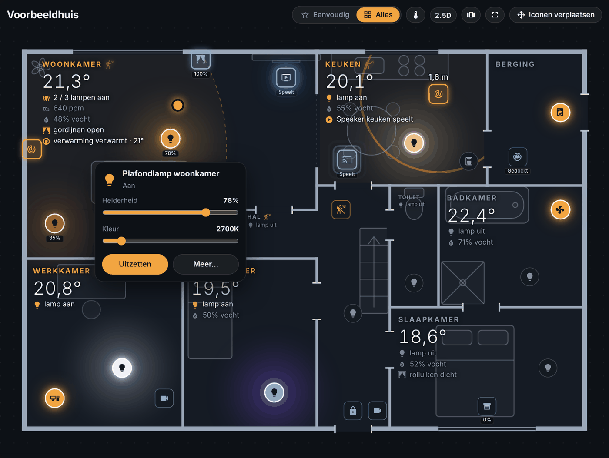

### Inzoomen op een ruimte


De rest van het huis wordt gedimd, zodat alleen de ruimte zelf helder blijft (ook muren en licht van andere ruimtes vallen weg), de ruimte komt groot in beeld en rechts staat alles uit die area: temperatuur, vocht, wie er is, meldingen, en een lijst van alle apparaten en sensoren. Tik op een regel om iets te schakelen, houd vast voor de details.

De lijst **In deze ruimte** staat ingeklapt; tik op de kop om hem te openen. Met het knopje rechtsboven in het paneel maak je het paneel **klein**: dan krijgt de ruimte de hele breedte en staat de kamertekst op de kaart.

Terug naar de hele plattegrond: **dubbeltik op de ruimte**, of tik op **Terug**. Dat werkt ook op de eigen pagina van een ruimte, en volledig scherm blijft aan.

### Op je telefoon: ruimte per ruimte

| Overzicht | Een ruimte |
|---|---|
|  |  |

Op een smal scherm (standaard smaller dan 560 pixels, dus de meeste telefoons) is de hele plattegrond te klein voor alle iconen. De kaart toont het huis dan **ruimte per ruimte**:

- Bovenaan staat een balk met **Overzicht** en al je ruimtes; schuif hem opzij. Een stipje betekent dat daar licht aan is.
- **Overzicht** toont het hele huis met alleen de namen en temperaturen. Tik op een ruimte om hem te openen.
- Een **ruimte** vult de hele breedte, met grote iconen die je makkelijk raakt. Erboven staan de naam, de temperatuur en de regels van het tekstblok. Alles buiten de ruimte wordt gedimd.
- **Veeg** over de plattegrond naar links of rechts voor de volgende of vorige ruimte.
- **Dubbeltik** op de ruimte om terug te gaan naar het overzicht.

Wil je dit ook op een tablet of pc? Tik in de werkbalk op het knopje **Per ruimte** (het icoon met de kaartjes). Nog een keer tikken geeft weer de **hele plattegrond**. Elk apparaat onthoudt zijn eigen keuze, dus je tablet kan per ruimte staan terwijl je pc de hele kaart laat zien.

Bij stap 5 stel je onder *Kleine schermen* in vanaf welke breedte dit vanzelf gebeurt, of zet je het altijd aan of uit. Per kaart kan dat ook met `compact: on` of `compact: off`.

### 2.5D: schuin van opzij

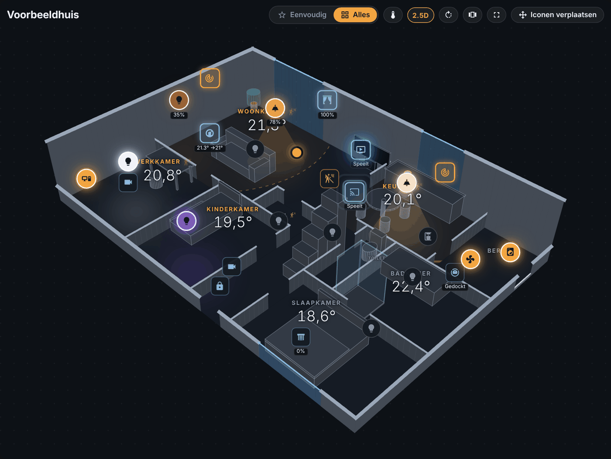

Met de knop **2.5D** in de werkbalk kantelt de plattegrond. De muren komen omhoog, ramen worden glas, meubels worden blokken en iconen hangen op hun hoogte (een plafondlamp hoog, een thermostaat op borsthoogte). Muren aan de voorkant en binnenmuren blijven laag, zodat je in elke ruimte kijkt. Er zit echt perspectief in: wat dichterbij is, is iets groter (uit te zetten bij stap 5). Lichtvlekken, de radar, open ramen en tikken op een ruimte werken gewoon mee.

| 2.5D recht | 2.5D in het thema Rock | Ingezoomd op een ruimte |
|---|---|---|
| 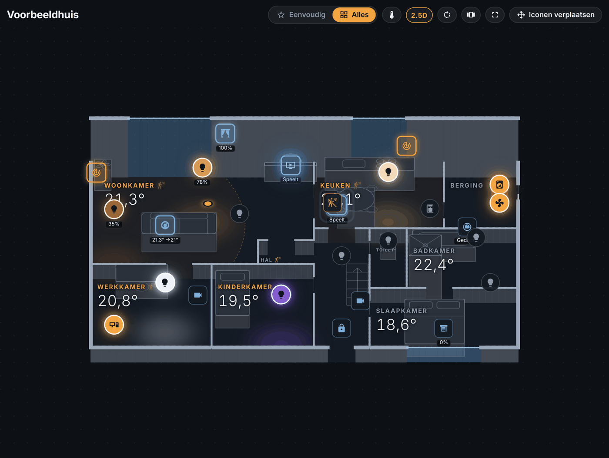 | 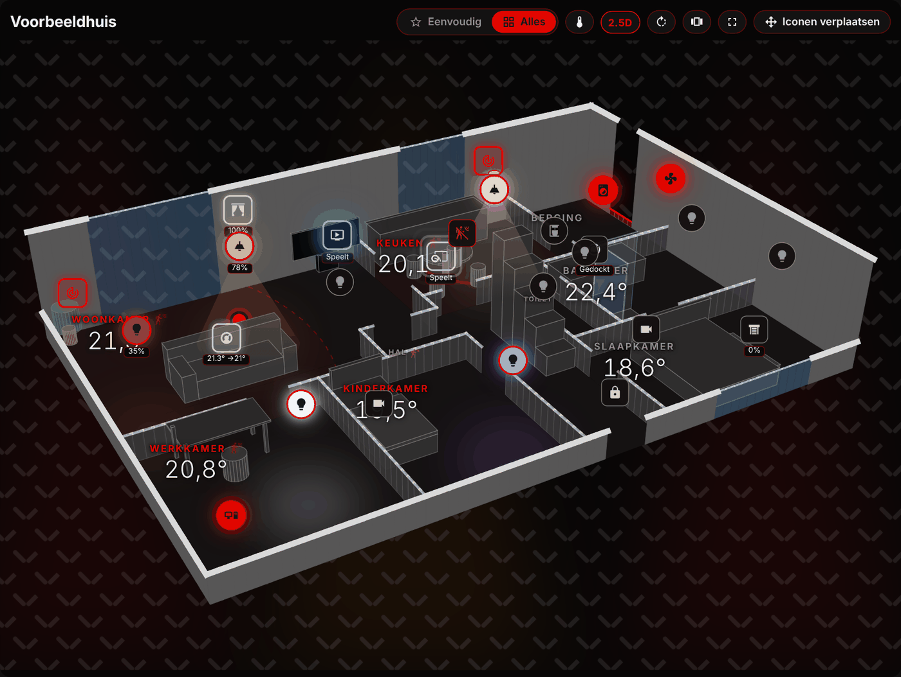 | 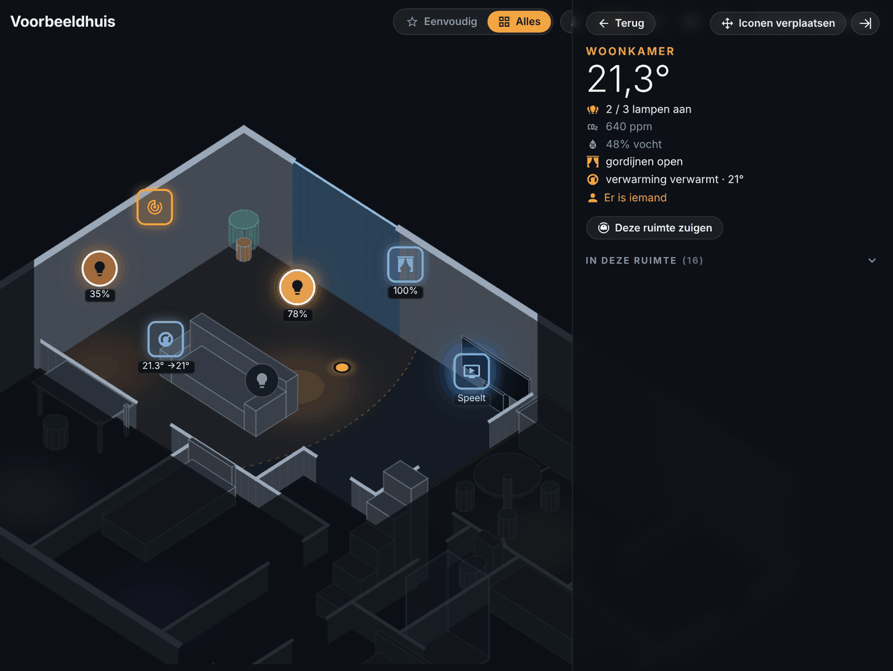 |

- **Draaien:** het draaiknopje springt per 45°. Vrij draaien en kantelen: met de muis de **rechtermuisknop** (of **Shift**) ingedrukt houden en slepen — links/rechts draait, omhoog/omlaag kantelt. Op telefoon of tablet: **twee vingers draaien**, en twee vingers samen omhoog of omlaag om te kantelen.
- **Zoomen:** Ctrl + scrollwiel of knijpen, net als in 2D.
- Elk scherm onthoudt zelf of het 2D of 2.5D gebruikt en onder welke hoek.
- **Iconen verplaatsen** gebeurt in 2D (precies); daarna staat alles meteen goed in 2.5D.

### Door je huis lopen

Met het **wandelmannetje** in de werkbalk loop je door je eigen huis, alsof je er echt bent. De muren, deuren en ramen staan op hun echte plek en maat (vul bij stap 2 de echte maat van een ruimte in), meubels staan erin, en lampen die aan zijn verlichten hun ruimte in hun eigen kleur. 's Avonds is het buiten donker en zie je vooral je lampen.

- De **rondleiding** begint vanzelf: bij de voordeur naar binnen, dan ruimte voor ruimte, door de deuren, om meubels heen. In elke ruimte kijkt hij even rond. Bovenin zie je de naam van de ruimte met temperatuur, vocht en hoeveel lampen er aan zijn.
- **Zoomen:** Ctrl + scrollwiel (of knijpen op touchpad of telefoon) zoomt de ruimte in en uit; de iconen blijven even groot. Gewoon scrollen = een stapje vooruit of achteruit.
- **Zelf rondkijken:** slepen. **Lopen:** tik op de vloer waar je heen wilt (hij loopt om muren en meubels heen), of gebruik de pijltjes of W A S D (Shift = sneller). Op een telefoon kun je ook de knoppen **Lopen** en terug ingedrukt houden. Tik op het kaartje rechtsboven om daarheen te lopen.
- Zodra je zelf iets doet, pauzeert de rondleiding; met **Verder** gaat hij door waar hij was.
- **Iconen** van de ruimte waar je bent (en wat dichtbij is) hangen op hun plek; tik op een lamp of schakelaar om hem aan of uit te zetten.
- Een deur met een sensor staat open of dicht zoals hij echt is. Ramen zijn glas met een kozijn; je kijkt naar buiten.
- **Ledstrips** gloeien als een band langs de lijn die je tekende, op hun eigen hoogte.
- **Bewerken** (alleen voor beheerders): tik op **Bewerken** onderin. Daarna:
  - **Apparaten verplaatsen:** sleep het icoontje. De eerste beweging bepaalt de richting en die blijft vast: **opzij** schuift het over de vloer (links/rechts zoals je kijkt), **omhoog/omlaag** verandert alleen de hoogte. Zo verschuift er nooit per ongeluk iets in de andere richting. Tik erop om het te kiezen; de **hoogte** kan ook met − en + per 10 cm.
  - **Ledstrip tekenen:** kies een lamp en tik **Ledstrip tekenen**. Zet de hoogte goed en tik punt voor punt op de muur of het meubel waar de strip loopt, dan **Klaar**.
  - **Meubels:** sleep een meubel over de vloer, of tik erop en draai het (15° of 90°) of haal het weg (ook met Delete).
  - **Opslaan** bewaart alles in je plattegrond (2D, 2.5D en de wandeling kloppen meteen); **Annuleren** gooit de wijzigingen weg.
- Je loopt nooit door een muur: de rondleiding gaat alleen door deuren en doorgangen, en een ruimte zonder deur slaat hij over. Ook zelf lopen stopt bij de muur.
- Sluiten met het kruisje of Esc. Heb je nog niet opgeslagen, dan waarschuwt hij eerst.
- Hoe hoog muren en iconen zijn stel je in bij stap 5 → *Telefoon, tablet en 2.5D*: de **echte maat** of een eigen percentage.

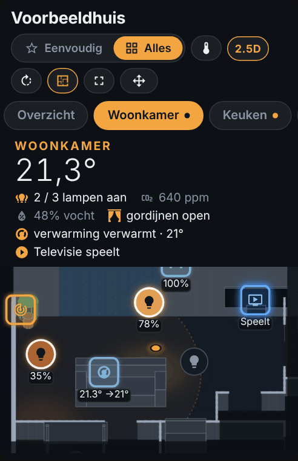

### Verdiepingen

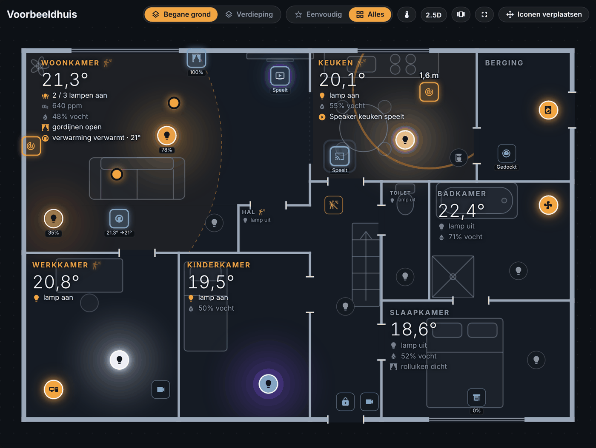

Heb je per verdieping een eigen plattegrond, zet dan in de kaart `floors: true` (alle plattegronden) of een lijst, bijv. `floors: [{ plan: thuis, name: Begane grond }, { plan: boven, name: Verdieping }]`. Bovenaan komen tabjes; elk scherm onthoudt de laatste.

### Camera


### Wat doet "Eenvoudig"?


Home Assistant onthoudt wie iets heeft bediend. Floorplan Studio telt alleen bediening door **mensen**: via het dashboard, de app, of een spraakassistent die via een HA-gebruiker werkt. Wat automatiseringen doen telt niet mee.

In Eenvoudig zie je alleen wat de laatste 14 dagen is gebruikt (instelbaar). De lijst past zich vanzelf aan: gebruik je iets nieuws, dan verschijnt het, en wat lang niet gebruikt is verdwijnt. Wat je op **Altijd tonen** zet, blijft altijd staan. In de eerste dagen na installatie toont hij nog alles, terwijl hij leert.

---

## 5. Extra's

### De zijkolom en de begroeting


Op het tabblad **Plattegrond** (en in kiosk) staat rechts een zijkolom, en linksboven een begroeting met wie er thuis is (personen met de status *thuis*).

| Onderdeel | Wat het doet |
|---|---|
| **Klok en datum** | Altijd zichtbaar. |
| **Weer** | Temperatuur, omschrijving, gevoelstemperatuur en wind. Tik voor de verwachting. |
| **Grote knop** | Standaard *Alles uit*: zet alle lampen op de kaart uit en laat zien in welke ruimtes nog licht brandt. Je kunt er ook een eigen script of scène aan hangen. |
| **Slimme knop** | Optioneel: per tijdvak een eigen naam en actie, zie hieronder. |
| **Knoppen** | Tot drie scènes, scripts of schakelaars (standaard je eerste scènes). |
| **Energie** | Zon nu, verbruik van het net (groen = je levert terug), stroomprijs, een balk hoeveel van je verbruik nu uit zon komt, en de zon-opbrengst van vandaag. |
| **Status** | Een korte lijst, bijv. stofzuiger en tv. |

Alles kies je bij stap 5 → **Zijkolom**; wat je leeg laat zoekt Floorplan Studio zelf. Op een smal scherm schuift de zijkolom onder de kaart. Wil je de kaart zonder zijkolom (bijv. op een ander dashboard)? Zet dan in de kaart `side: false`.

### De slimme knop

Bij stap 5 → **Zijkolom → Slimme knop** geef je de grote knop per deel van de dag een eigen naam, onderschrift en actie (een scène, script of automatisering). Zolang er nog licht aan is kan hij iets anders doen. Een voorbeeld:

| Vanaf | Naam | Doet | Als er licht aan is |
|---|---|---|---|
| `05:00` | Goedemorgen | scène *Ochtend* | – |
| `11:00` | Thuiskomen | scène *Avond* | **Alles uit** (lampen uit) |
| `22:30` | Naar bed | script *Slapen* | – |

- **Vanaf** is een tijd (`06:30`) of `sunrise` / `sunset`, eventueel met minuten erbij of eraf: `sunset-30` is een half uur voor zonsondergang.
- Na middernacht geldt het laatste tijdvak van de vorige dag nog, tot het eerste tijdvak begint.
- Laat je **Doet** leeg, dan zet de knop alle lampen op de kaart uit.
- **Wat telt als "licht aan"**: standaard een lamp op de kaart, maar je kunt ook één lamp of groep kiezen.
- Het icoon past zich aan de naam aan (bed, zonsopkomst, huis, aan/uit).

### De tekstblokken bij de ruimtes

Elke ruimte heeft een tekstblok met de naam, een grote waarde (meestal de temperatuur) en korte regels met een icoon:
- lampen aan (bijv. *13 / 14 lampen aan*);
- CO2, met *luchten* in oranje boven 1000 ppm;
- vochtigheid;
- gordijnen of rolluiken (*open*, *dicht* of een percentage);
- verwarming of airco (*airco verwarmt · 21°*);
- wat er speelt;
- en tot drie extra regels die je zelf kiest (stap 2).


Het blok zoekt zelf de plek in de ruimte met de minste iconen eronder. Wil je het anders (alleen beheerders):
- **Sleep een blok** gewoon naar een andere plek (indrukken en bewegen).
- **Groter of kleiner**: wijs het blok aan met de muis; rechtsonder verschijnt een **oranje hoekje** om aan te trekken.
- **Houd het blok even vast** (zonder te bewegen) voor een menu: *Verplaatsen*, *Groter*, *Kleiner*, *Automatische plek en grootte* (terug naar de vrijste plek) en *Verbergen* (of weer *Tonen*).
- In **Iconen verplaatsen** zie je ook verborgen blokken doorschijnend, zodat je ze terug kunt zetten.
- Kort tikken op een blok doet hetzelfde als tikken op de ruimte.
 Een zacht knipperend bewegingsicoontje achter de naam betekent dat er iemand is. Regels die je niet wilt zet je uit bij stap 5.

### Licht

Een lamp die aan is geeft een zachte lichtvlek in zijn eigen kleur op de vloer. Bij stap 5 kun je in plaats daarvan de hele ruimte laten gloeien, of de gloed uitzetten.

Een dimbare lamp laat ook zien hoe fel hij staat: hoe lager de lamp staat, hoe zachter de knop en de lichtvlek, en het percentage staat erbij. Bij stap 5 kies je bij *Sterkte van lampen*: *altijd onder de lamp*, *alleen bij aanwijzen* (dan zie je het percentage naast de naam als je met de muis op de lamp staat) of *niet tonen*.

Een **tv** die aan staat gloeit zacht blauw, een **speaker** die speelt zendt kleine geluidsgolfjes uit.

### Ruimtes kleuren op temperatuur


Tik op de **thermometer** in de werkbalk. Elke ruimte kleurt dan van **blauw** (koud) via **groen** naar **oranje/rood** (warm). Bij welke temperaturen dat gebeurt stel je in bij stap 5 (standaard 17 °C en 24 °C). Daar kun je het ook standaard aanzetten. Ruimtes zonder temperatuursensor houden hun gewone kleur.

### Aanwezigheid


- **Icoontje bij de naam:** staat er in de area van een ruimte een **beweging-, aanwezigheids- of bezettingssensor** aan, dan krijgt de naam een bewegingsicoontje (ook op de kamertegel van de startpagina). Detectie van dieren of auto's door camera's (bijv. Frigate `…_dog_occupancy`) telt niet mee.
- **Personen per ruimte:** heb je per persoon een sensor die zegt in welke ruimte iemand is (bijv. [Bermuda](https://github.com/agittins/bermuda) of [ESPresense](https://espresense.com)), koppel die dan bij stap 5 → **Aanwezigheid**. De waarde van de sensor moet de naam van de ruimte of de area zijn. Er verschijnt dan een rondje met de foto of de initialen van die persoon in de ruimte. Wie op "niet thuis" staat, wordt niet getoond.

- **Uitdoven:** na de laatste beweging kleurt het icoontje in een paar minuten (instelbaar, standaard 5) langzaam terug naar grijs. Zo zie je ook waar *net* iemand was.

### Radar (mmWave)

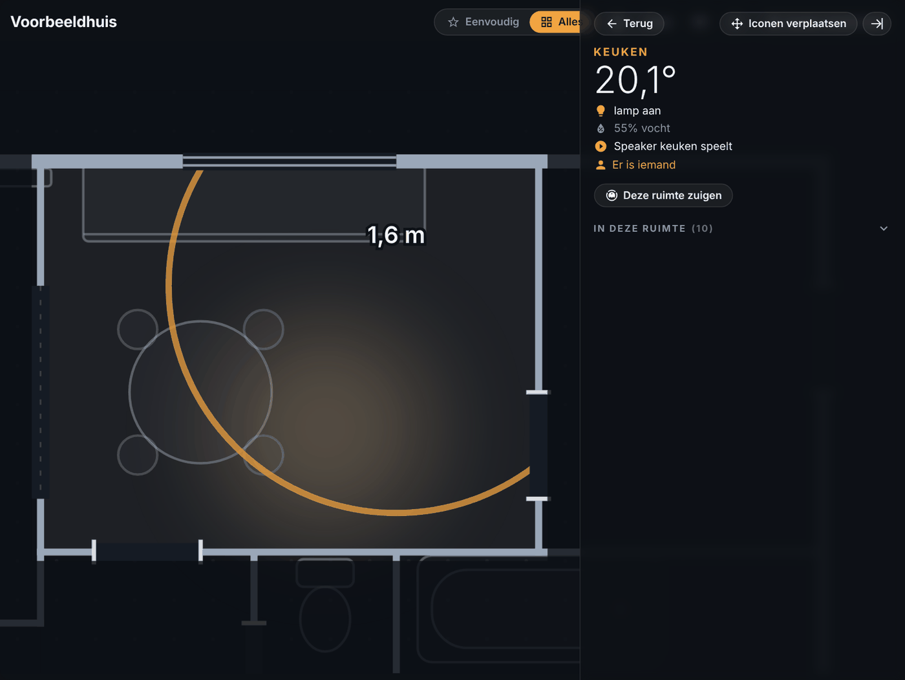

Aanwezigheidssensoren met radar kunnen meer dan aan/uit:

- Sensoren die alleen een **afstand** geven (zoals Tuya 24G en LD2410) tonen een **ring** rond de sensor op de gemeten afstand, met het bereik als lichte gestippelde cirkel. De afstand staat er klein bij.
- Sensoren die een **plek** geven (LD2450, tot drie personen) tonen een **stip per persoon**. Bij stap 4 stel je in naar welke kant de sensor kijkt.
- De radar ziet alleen binnen zijn eigen ruimte.
- Hangt de sensor aan het plafond, vul dan bij stap 4 de **hoogte** in: dan rekent hij de afstand over de vloer uit (een plafondsensor meet schuin naar beneden).
- Voor de juiste afstand moet de plattegrond zijn echte maat kennen (stap 2).

### Meldingen op de kaart


- **Alarm** – rook, gas, koolmonoxide en lekkage: de ruimte **knippert rood** en bovenaan verschijnt een rode balk met wat er aan de hand is. Tik op de melding om naar de ruimte te zoomen.
- **Open deur of raam** – de ruimte kleurt rustig **oranje** en er staat een oranje balk bovenaan.


Het werkt met elke `binary_sensor` met de juiste *apparaatklasse* in de area van de ruimte. Sensoren met de klasse *hitte* of *veiligheid* tellen bewust niet mee: die worden vaak gebruikt voor een brandende ketelvlam of de status van een NAS, en zouden dan steeds alarm geven. Het werkt ook in kiosk. Beide soorten kun je bij stap 5 uitzetten.

### De stofzuiger live op de kaart


Terwijl de stofzuiger zuigt, **rijdt zijn icoon over je plattegrond** naar waar hij echt is, met een stippellijn van waar hij net geweest is. Staat hij weer in het dock, dan gaat het icoon terug naar zijn eigen plek. In *Eenvoudig* is een rijdende stofzuiger altijd zichtbaar.

Floorplan Studio haalt de positie uit de kaart van de stofzuiger zelf (de robot is daar het witte rondje); die kaart hoef je niet te zien. Wil je hem toch zien, kies dan bij stap 5 → **Stofzuiger → Wat je ziet tijdens het zuigen** voor *de kaart van de stofzuiger* of *allebei*.

- **Nodig:** kies bij stap 1 de **stofzuigerkaart als achtergrond** en leg hem over je ruimtes. Zo weet Floorplan Studio hoe zijn kaart op jouw plattegrond valt (ook als je hem gedraaid of gespiegeld hebt). Zonder achtergrond blijft het icoon op zijn vaste plek.
- Bij stap 5 → **Stofzuiger** kies je: alleen tijdens het zuigen (standaard), altijd, of uit; wat je ziet (alleen de robot, de kaart, of allebei); en hoe doorzichtig de kaart is.
- Het werkt met elke integratie die de kaart als `image.`- of `camera.`-entiteit geeft (Roborock, Valetudo, Xiaomi Cloud Map Extractor, Dreame…).

### Deze ruimte zuigen


Zoom in op een ruimte en tik op **Deze ruimte zuigen**.

- Op nieuwere Home Assistant-versies gebruikt dit **Schoonmaken per area** (`vacuum.clean_area`). Koppel daarvoor eenmalig in HA de segmenten van je stofzuiger aan je areas: open de stofzuiger-entiteit → tandwiel → *Map vacuum segments to areas* (in het Nederlands iets als "segmenten aan areas koppelen").
- Kent je HA dat nog niet, dan zie je bij stap 2 per ruimte een veld **Nummer van deze ruimte in je stofzuiger** waar je dat nummer invult (Roborock: `app_segment_clean`).

---

### AI-assistent: apparaten plaatsen door het te vragen

Floorplan Studio werkt samen met de AI-assistent van Home Assistant (bijv. Google AI, OpenAI, Ollama of Extended OpenAI Conversation). Vraag gewoon *"Hang de keukentafellampen boven de eettafel op 1,8 meter"* of *"Zet de bewegingssensor rechtsboven in de hoek van de badkamer"*, en het icoon staat meteen goed: op het dashboard, in 2.5D en in de wandeling. Open kaarten werken zichzelf bij.

- **Werkt voor iedereen, ook zonder AI:** in de editor staat bovenaan de keuze **Floorplan Studio (zonder AI)**. Die begrijpt korte opdrachten zelf, zoals *"zet Keukenlamp boven de eettafel"* of *"hang Lamp hal in het midden van de hal op 2,4 m"* (noem het apparaat zoals het in Home Assistant heet). Er is niets extra's voor nodig. Met een AI-assistent kun je daarnaast gewoon een gesprek voeren.
- **In de editor:** rechtsonder zit de knop **AI-hulp**. Kies bovenin de assistent; je chat in het venster, en wat de assistent verplaatst zie je direct op de tekening. Heb je nog niet opgeslagen, dan slaat hij eerst op, zodat de assistent je laatste versie ziet.
- **Wat de assistent kan:** twee hulpmiddelen. **FloorplanDescribe** geeft de plattegrond (ruimtes, meubels en apparaten met hun plek in meters). **FloorplanPlaceDevice** zet een apparaat ergens neer: *boven/op/naast* een meubel (tafel, bank, bureau, kast, aanrecht, bed, tv ...), *tegen de linker/rechter/boven/onder muur*, *in een hoek* of *in het midden*, met eventueel een hoogte en *plafond/hangend/muur/vloer/tafel*.
- **Elke AI-assistent werkt:** de editor geeft de assistent de plattegrond mee en vraagt om een kort lijstje verplaatsingen terug, dat Floorplan Studio zelf uitvoert. Je hoeft bij je assistent dus niets in te stellen.
- **Assistent instellen (voor spraak of de Assist-knop):** bij een assistent die de officiële AI-koppeling van Home Assistant gebruikt (Google AI, OpenAI, Ollama, Anthropic) zet je in de instellingen van die assistent **Home Assistant besturen (Assist)** aan; de hulpmiddelen staan er dan vanzelf bij. Andere assistenten kunnen de acties hieronder gebruiken.
- **Ook als actie** voor automatiseringen, scripts of je eigen assistent via de API: `floorplan_studio.place_device` (één zin in `text`, of de velden `device`, `room`, `spot`, `height`, `mount`) en `floorplan_studio.describe` (geeft de plattegrond terug als antwoord).

```yaml
action: floorplan_studio.place_device
data:
  device: Keukentafel 1
  room: Eettafel
  spot: boven de tafel
  mount: hanging
  height: 1.8
```

## 6. Thema's

| | |
|---|---|
|  **Automatisch (zon)** – overdag licht, rond zonsondergang via een warme schemer naar donker en 's ochtends weer terug. Rekent met de zonsopkomst en -ondergang van vandaag; de tekst blijft altijd leesbaar. |  **Warm** – donker met amberkleurig licht. Rustig voor de huiskamer. |
|  **High-tech** – neon-HUD met cyaan muren, raster en scanlijnen. |  **Rock** – zwarte traanplaat, chromen muren en rode podiumspots. |
|  **Blueprint** – blauw bouwtekening-papier met witte lijnen. |  **Glas** – matglas over zachte kleurvlekken. |

Verder: **Terminal** (groene fosforkleur) en **Home Assistant** (volgt je HA-thema).

### Thema kiezen
- **Per kaart:** in de kaartinstellingen. Met **Thema-knoppen tonen** kan iedereen zelf wisselen; zonder thema-keuzelijst onthoudt elk apparaat zijn eigen keuze. Met een thema-keuzelijst wissel je het thema voor het hele huis, en zie je alleen de thema's die in die lijst staan.
- **Voor het hele huis tegelijk:** stap 5 → **Eén thema voor het hele huis**. Klik **Keuzelijst maken** (of kies een keuzelijst die je al hebt). Elk scherm volgt dan die lijst, en wisselen op één scherm wisselt overal. Je kunt het thema dan ook met een automatisering zetten, bijvoorbeeld:

  ```yaml
  action: input_select.select_option
  target:
    entity_id: input_select.floorplan_thema
  data:
    option: Rock
  ```

---

## 7. Uitproberen met het voorbeeldhuis

In de map [`examples`](../examples) staat [`voorbeeldhuis.json`](../examples/voorbeeldhuis.json): het verzonnen huis uit deze handleiding (9 ruimtes, deuren en 22 apparaten).

1. Download het bestand.
2. Open **Floorplan** → knop **Importeren** (naast de **+**) → kies het bestand.
3. Je krijgt een nieuwe plattegrond. De apparaten heten `light.woonkamer_plafond` enz. en bestaan bij jou niet; ze staan grijs op de kaart. Koppel bij stap 2 de ruimtes aan je eigen areas en klik bij stap 4 op **Alles vanzelf neerzetten** om je eigen apparaten te krijgen.

Met **Exporteren** maak je zo'n bestand van je eigen plattegrond, bijvoorbeeld als back-up of om te delen.

---

## 8. Tips

- **Meerdere verdiepingen:** maak met **+** een tweede plattegrond en zet in de kaart `floors: true` voor tabjes, zie [Verdiepingen](#verdiepingen).
- **Editor uit de zijbalk:** gebruik je de editor zelden, of wil je hem niet in de zijbalk van iedereen? Ga naar Instellingen → Apparaten & diensten → Floorplan Studio → **Configureren** en zet *Floorplan in de zijbalk laten zien* uit. De kaart blijft werken; de editor open je dan via het adres `/floorplan-studio`.
- **Groepen:** heb je een lampengroep, bijvoorbeeld "Woonkamer sfeer"? Zet dan de groep op de kaart, of juist de losse lampen. Voor de gloed van een kamer tellen alleen echte lampen mee.
- **Een plattegrond verwijderen:** met het prullenbak-icoon in de editor. Heb je bij stap 6 een dashboard laten maken, dan verdwijnt dat dashboard (en de link in de zijbalk) automatisch mee. Dashboards waarin je de kaart zelf hebt geplaatst blijven staan.
- **Back-up:** alles staat in `.storage/floorplan_studio.*` en zit dus in je gewone HA-back-up.

## 9. Problemen oplossen

| Probleem | Oplossing |
|---|---|
| "Deze integratie ondersteunt geen configuratie via de UI" | Floorplan Studio is nog niet gedownload in HACS, of Home Assistant is daarna nog niet herstart. Download, herstart, en voeg de integratie dan toe. |
| *Floorplan* staat niet in de zijbalk | Ben je beheerder? Is de integratie toegevoegd (stap 4 van installeren)? |
| Kaart zegt "Nog geen plattegrond" | Open Floorplan, teken iets en klik **Opslaan**. |
| Kamer toont geen temperatuur | Zit de sensor in dezelfde area? Of kies hem bij de ruimte in stap 2. |
| Apparaat komt niet bij "automatisch plaatsen" | Hangt het apparaat aan de area? Verborgen entiteiten en configuratie-entiteiten worden overgeslagen. Voeg het anders toe via het zoekveld. |
| Stofzuiger beweegt niet over de kaart | Heeft je plattegrond een achtergrond van de stofzuigerkaart (stap 1)? Zonder die achtergrond weet Floorplan Studio niet waar zijn kaart op jouw plattegrond valt. Kies bij stap 5 ook de juiste stofzuiger en kaart. |
| Stofzuiger rijdt op de verkeerde plek | Leg de achtergrond bij stap 1 nauwkeuriger over je ruimtes (schuifjes, draaien, spiegelen). |
| "Ongeldige optie" bij het wisselen van thema | Het thema staat niet in je thema-keuzelijst. Voeg het toe aan die lijst (Instellingen → Apparaten & diensten → Helpers). |
| Tekstblok laat zich niet slepen | Alleen beheerders kunnen tekstblokken verplaatsen. Ververs na een update de pagina (Ctrl+F5). |
| "Deze ruimte zuigen" ontbreekt | Er moet een stofzuiger op de kaart staan (of gekozen zijn bij stap 5), en de ruimte moet aan een area hangen. Op oudere HA: vul de segmenten in bij stap 2. |
| Menubalk in kiosk ontbreekt | Staat `?kiosk` achter het adres? Maak het dashboard opnieuw (stap 6) als het met een oudere versie gemaakt is. |
| Oude versie na update | Ververs de browser met Ctrl+F5, of in de app: Instellingen → App-configuratie → Frontend-cache wissen. |
| De radar-ring is veel te groot | Vul bij stap 2 de echte maat van een ruimte in, en bij een plafondsensor bij stap 4 de hoogte. Zet het icoon waar de sensor echt hangt. |
| In 2.5D staat iets aan de verkeerde kant van een muur | Stuur een screenshot met de hoek erbij via een issue. Met het draaiknopje (45°-standen) ziet het er altijd goed uit. |

Vragen of ideeën? Open een issue op [GitHub](https://github.com/trackerr/home-assistant-floorplan-studio/issues).
